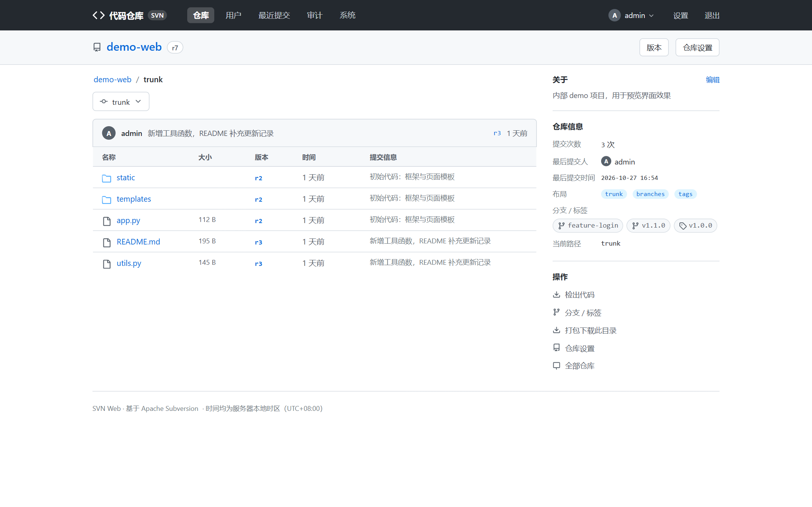
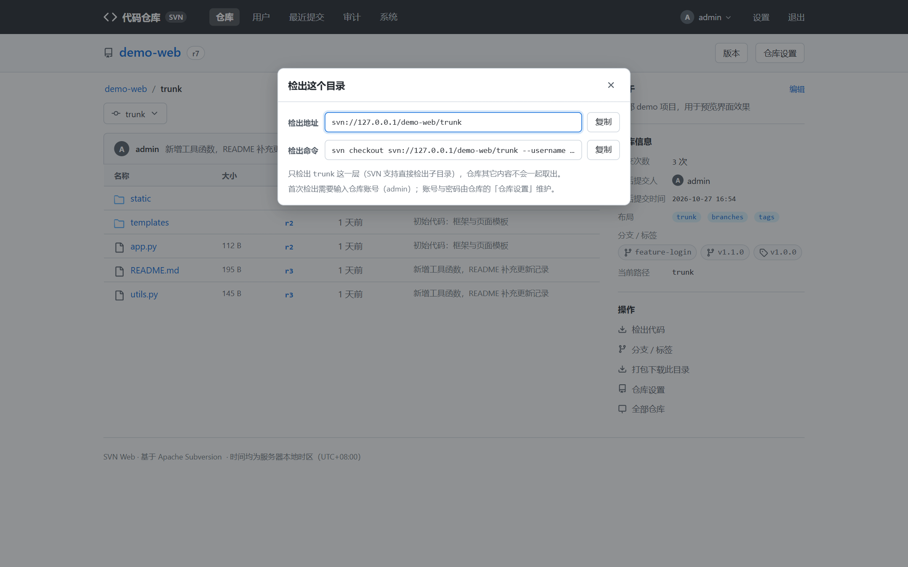
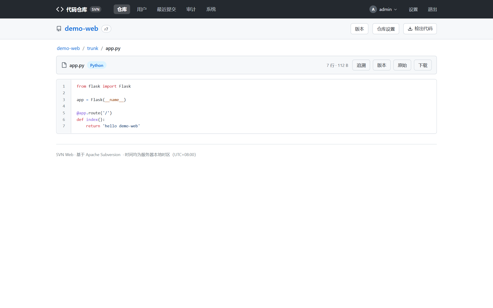
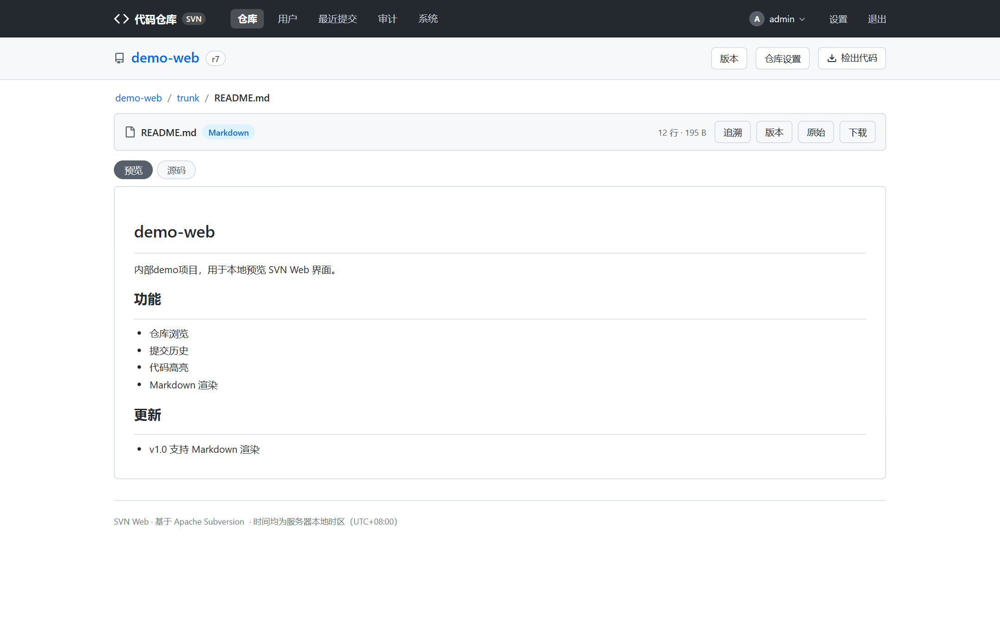
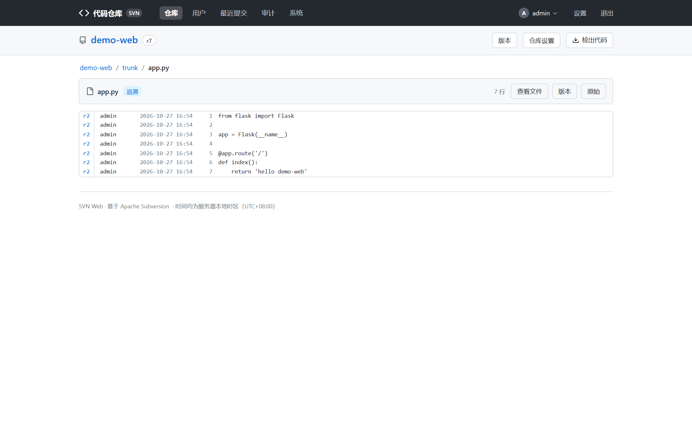

# 代码浏览

日常看代码用到的所有功能，都在这一篇。

## 仓库列表（首页）

- 登录后首页列出 `repo_root` 下所有「含 `db` 子目录」的文件夹（即真实 SVN 仓库）。
- 顶部搜索框可按仓库名 / 描述过滤。
- 每个仓库卡片显示描述、最近提交等摘要；点击进入目录树。

> 归档的仓库不出现在列表中，管理员可在「已归档仓库」页恢复或彻底删除，
> 见 [仓库管理 → 归档与恢复](repo-admin.md#归档与恢复)。

## 目录树

- 面包屑导航逐级展示路径，点击任意一级即可回跳。
- **SVN 标准布局识别**：仓库根下存在 `trunk / branches / tags` 时，页头出现快捷导航；
  分支 / 标签目录支持快速切换下拉（见左上「trunk」切换器）。
- 目录条目显示名称、最近一次提交信息与时间。
- 「检出代码」按钮弹出检出地址弹窗：地址就是**当前所在目录**（不是仓库根），
  可以直接复制 `svn checkout` 命令：

## 文件查看（blob）

点击文件进入文件视图，按文件类型自动选择展示方式：

| 类型 | 展示方式 |
| --- | --- |
| 代码 / 文本 | Pygments 语法高亮，带行号 |
| `.md` / `README` | 轻量 Markdown 渲染成 HTML（超长内容自动截断） |
| 图片 / PDF / 音视频 | 浏览器内联预览（流式，MIME 白名单） |
| 超大文件 | 超过预览上限时只提供下载，不再在线读取 |

代码 / 文本文件带行号语法高亮：

`.md` / `README` 自动渲染成页面：

文件页顶部提供一组动作按钮：

- **追溯**：Blame 逐行追溯，见下文。
- **版本**：跳到该文件的版本历史。
- **原始内容**（原始）：不经高亮渲染，直接输出源文件。
- **下载**：流式下载单个文件。

> 安全说明：媒体预览白名单**刻意不含 html / htm / js**，防止同源脚本注入。

## Blame 逐行追溯

文件视图点「追溯」进入：每行代码旁标注最后一次修改它的版本号、作者与提交时间，
点击版本号可跳到该次提交详情。适合排查「这行为什么改成这样」。

## 打包下载

目录页提供「打包下载」：把当前目录打成 zip 下载。目录体积超过上限时返回 413，
请改用 `svn checkout`。

## 面包屑与键盘习惯

- 顶部面包屑始终显示 `仓库名 / 目录 / 子目录 / 文件`，任意一级可点击回跳。
- 页面切换走 pjax 局部刷新，只有内容区重载，顶部进度条反馈加载状态。

## 相关文档

- 查文件改动历史 → [历史与搜索](history-search.md)
- 建 / 删仓库、管账号权限 → [仓库管理](repo-admin.md)
