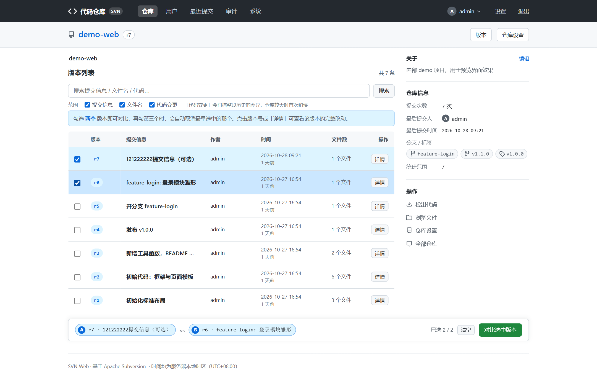
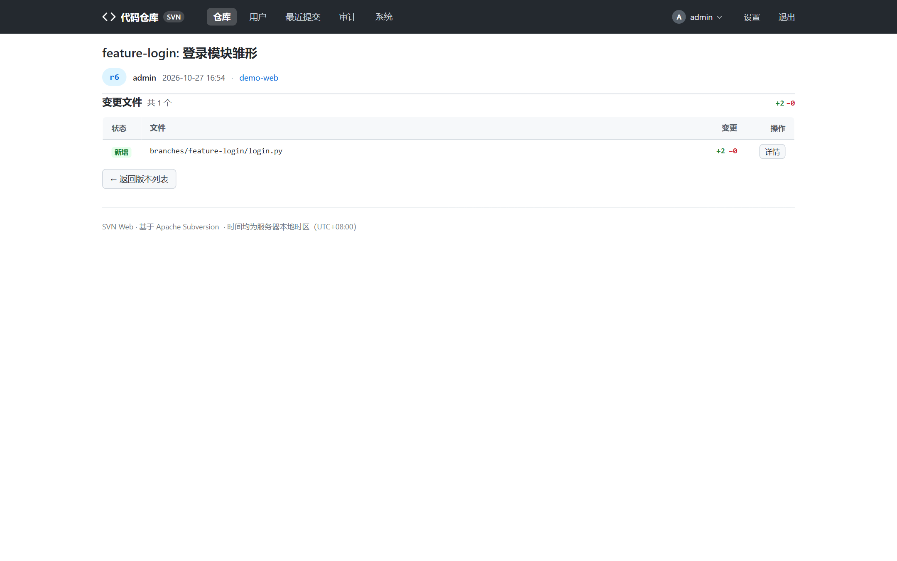
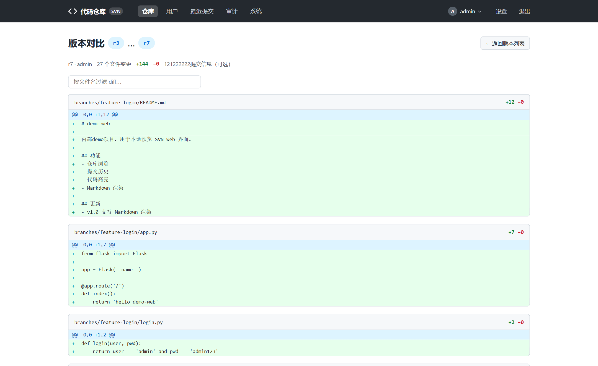
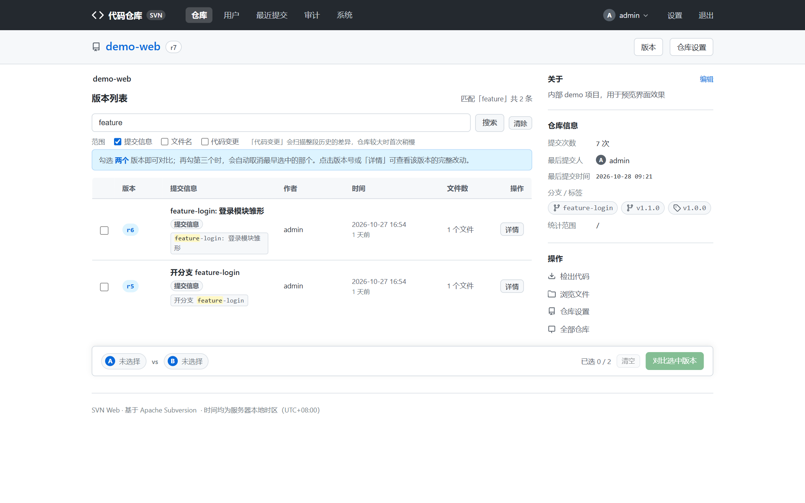
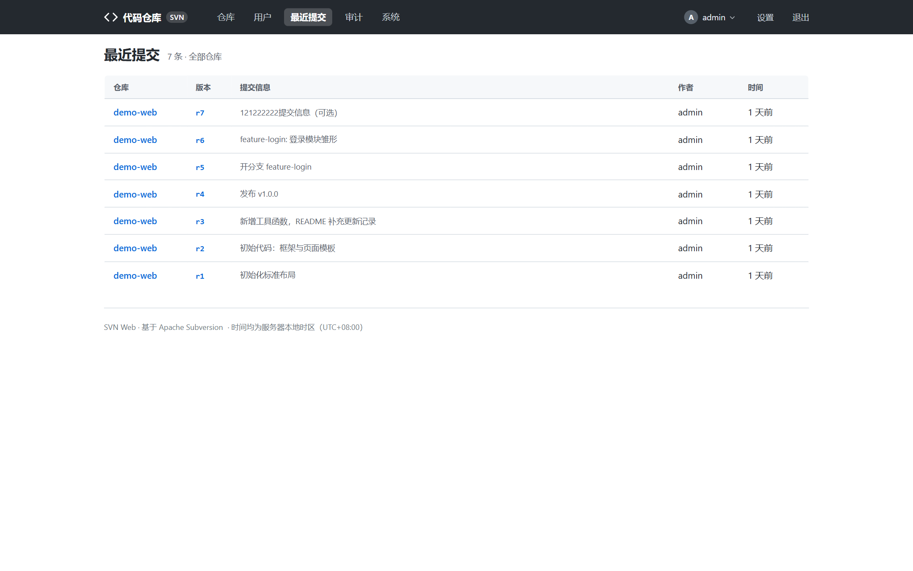

# 历史与搜索

查历史、比版本、搜代码，都在这一篇。

## 版本列表

入口：仓库页 → 「版本」（或直接访问 `/<仓库名>/versions/`）。

- 真表格分页展示（默认每页 60 条），每行含版本号、作者、提交信息、时间、变更文件数。
- **勾选对比**：勾选两个版本（最多同时选中两个）即可发起这两个版本区间的 diff 对比。
- 顶部搜索框即「全历史搜索」，见下文。
- 列表底部「加载更多」按 `?before=` 游标翻页。

在目录 / 文件页进入版本列表时，自动只显示**该路径下**的历史。

## 版本详情

点击版本号进入单次提交详情页：

- 元信息：作者、时间、提交信息（无提交信息显示占位文案）。
- 变更文件清单：新增 / 修改 / 删除分别标注；点击任意文件进入**单文件变更详情**，
  只看该文件在这次提交中的改动 diff。

## 版本区间对比

两种发起方式：

1. 版本列表勾选两个版本 → 「对比」。
2. 直接访问 `/<仓库名>/compare/revisions/?a=<旧版本>&b=<新版本>`。

结果页展示区间内所有文件的 diff，可按文件筛选查看：

## 全历史搜索（三档范围）

版本页搜索框支持 `scope` 参数，也可以在 UI 上切换范围（页面顶部的「范围」勾选项）：

| 范围 | 匹配内容 | 说明 |
| --- | --- | --- |
| `msg`（提交信息） | 提交信息文本 | 走 `svn log`，速度最快 |
| `path`（文件名） | 变更路径 / 文件名 | 走 `svn log -v` |
| `code`（代码变更） | 每次提交的代码内容（含 diff） | 需要扫描每次提交的文件内容 |

- 三档均为**不区分大小写的子串匹配**。
- **代码搜索**背后有扫描缓存（带 TTL），第二次搜同样的词会明显加速；
  超大仓库触发扫描超时 / 超预算保护时，页面会如实提示「结果可能不完整」，
  缓存命中后自动补全，也可由管理员调大 `search_scan_timeout` 配置。
- 被删除文件的内容也能搜到（删除那次提交的文件内容会通过 `svnlook cat` 补全，
  有单文件大小上限保护）。

## 最近提交（全局动态）

顶部导航「最近提交」聚合**所有仓库**的提交流水（每仓限量、总量限量），
适合每天扫一眼全服动态；点击任意条目跳转对应提交详情。

## 相关文档

- 看不懂 diff 里的路径 → [代码浏览](browsing.md)
- 搜索提示不完整的调参 → 根目录 `README.md`「配置说明」
