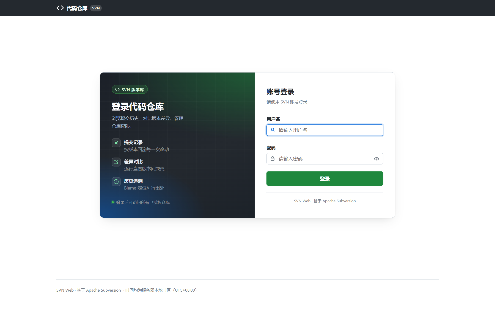
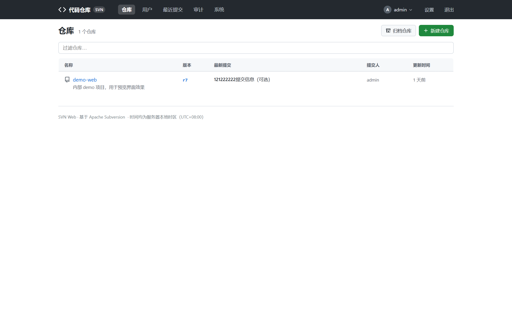

# 快速上手

本文覆盖从零部署到第一次登录浏览的完整流程。生产部署细节（systemd、nginx、HTTPS）
见根目录 `README.md` 的「部署说明」一节。

## 前提条件

- 机器上已安装 **Subversion**（提供 `svn` / `svnlook` / `svnadmin` 命令）。
- **Python ≥ 3.8**。
- 推荐部署在 **Linux** 服务器上。Windows 仅保证程序能运行（代码浏览不受影响），
  管理类功能不保证可用，原因见根目录 `README.md` 第七节补。

## 方式一：一键安装（Linux，推荐）

```bash
wget -O install.sh https://raw.githubusercontent.com/wenjiangs/svnweb/main/deploy/install.sh
bash install.sh
```

脚本先做**纯只读环境检查**（Python / SVN 工具链 / 端口 / 权限 / systemd），任何一项
不满足即停止且不在系统上产生文件；通过后自动安装到 `/opt/svnweb` 并注册 systemd 服务
`svnweb`，监听 `37245` 端口。

常用变体：

```bash
bash install.sh --dir /opt/svnweb --port 37245   # 自定义目录与端口
bash install.sh --no-service                     # 只装文件，不创建服务
```

## 方式二：手动安装

```bash
git clone https://github.com/wenjiangs/svnweb.git && cd svnweb/python
python3 -m venv venv
venv/bin/pip install -r requirements.txt
venv/bin/waitress-serve --listen=0.0.0.0:37245 app:app
```

## 首次访问：安装向导

浏览器打开 `http://<服务器IP>:37245`，首次访问会自动进入**安装向导**（`/install`）：

1. 页面自带环境自检报告（Python 版本、SVN 工具链、svnserve 端口监听状态）。
2. 按提示填写：
   - **仓库根目录**：SVN 仓库的父目录，需与 svnserve 的 `-r` 参数一致（默认 `/svn`）。
   - **检出地址前缀**：对外展示的 `svn://` 地址（支持自定义 SVN 端口）。
   - **第一个管理员账号密码**。
3. 提交即生成 `config.json` 并**立即生效，无需重启**；此后向导永久关闭，
   不会被他人重装覆盖。

> 也可以用命令行代替网页向导：`python3 init_config.py`（可交互生成配置，自动备份旧文件）。

## 登录



- 打开站点任意页面，未登录会被引导到登录页。
- 连续输错密码达到上限（默认 5 次）会临时锁定（默认 300 秒），防止暴力破解。
- 登录后右上角可**在线修改密码**，改密后当前会话不掉线。

## 界面总览

登录后进入首页（仓库列表）：



| 区域 | 说明 | 详细文档 |
| --- | --- | --- |
| 仓库列表（首页） | 全部仓库卡片 + 搜索过滤，显示描述、版本数等摘要 | [代码浏览](browsing.md) |
| 最近提交 | 聚合所有仓库的提交流水，全局动态页 | [历史与搜索](history-search.md) |
| 仓库内导航 | trunk / branches / tags 快捷导航 + 分支快速切换 | [代码浏览](browsing.md) |
| 管理入口（仅管理员可见） | 新建仓库、用户管理、设置、审计、系统状态 | [仓库管理](repo-admin.md) / [系统与运维](system-ops.md) |

## 下一步

- 想看代码 → [代码浏览](browsing.md)
- 想查历史、搜代码 → [历史与搜索](history-search.md)
- 管理员 → [仓库管理](repo-admin.md)、[用户与角色](users-roles.md)、[系统与运维](system-ops.md)
