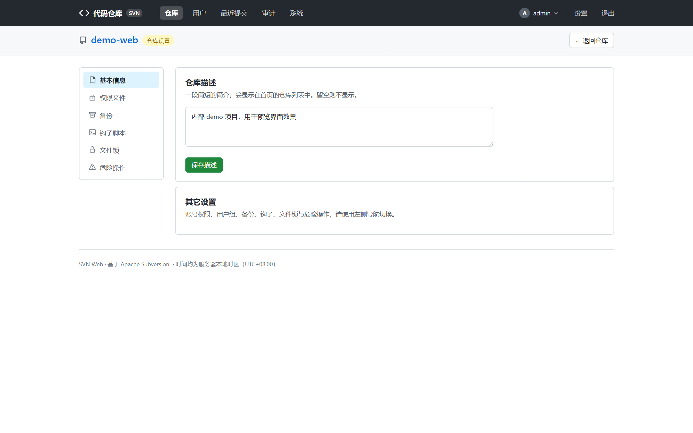
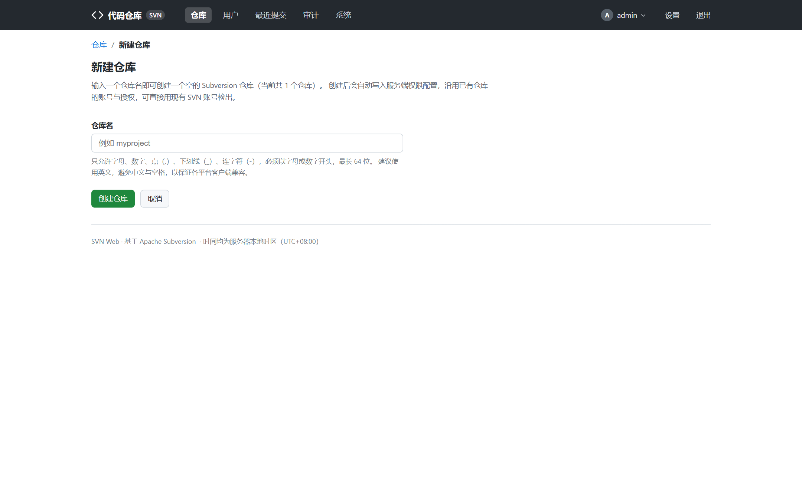
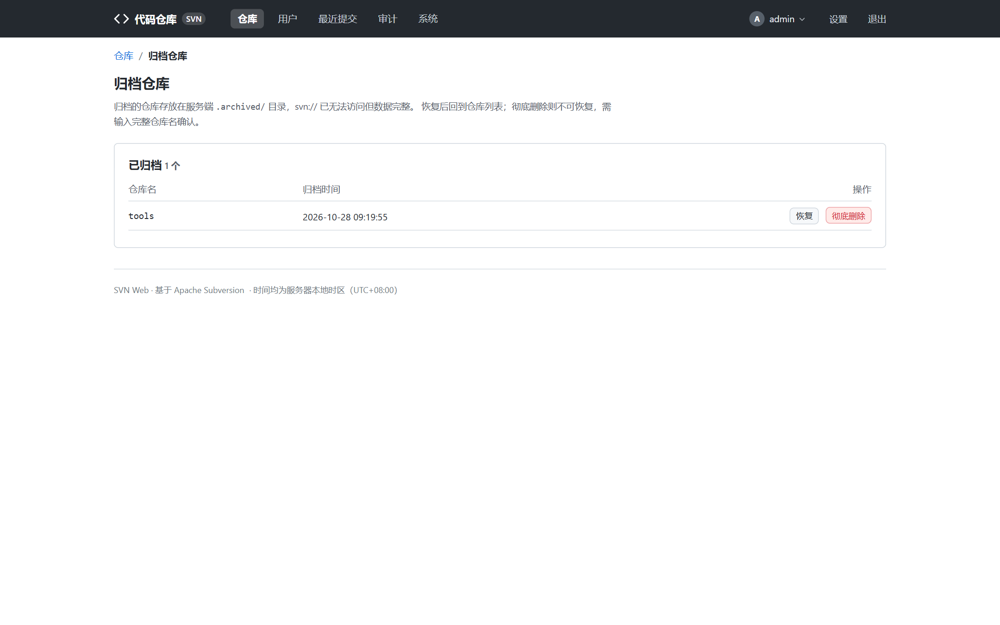
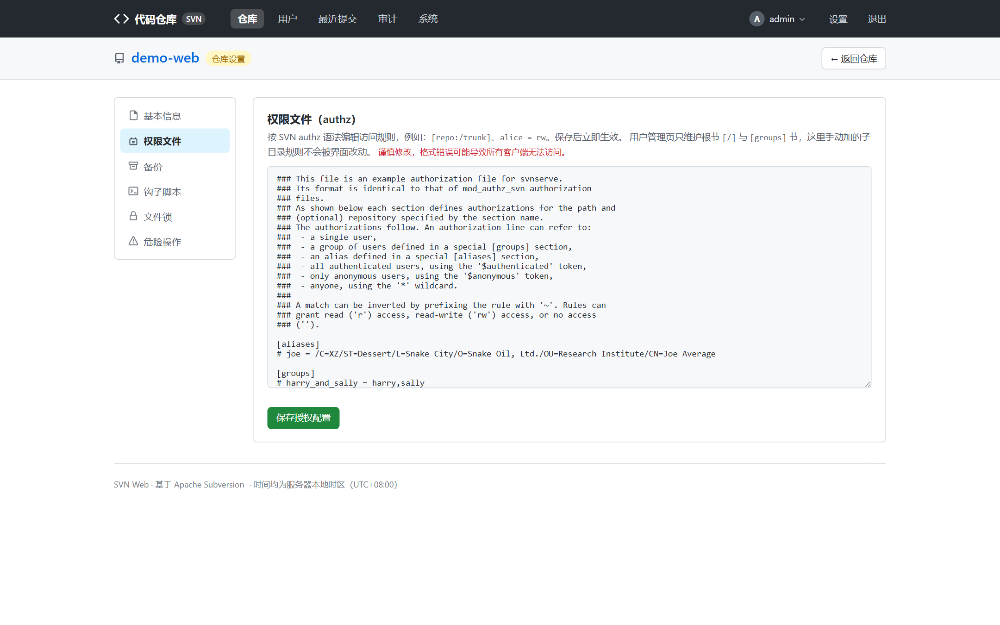
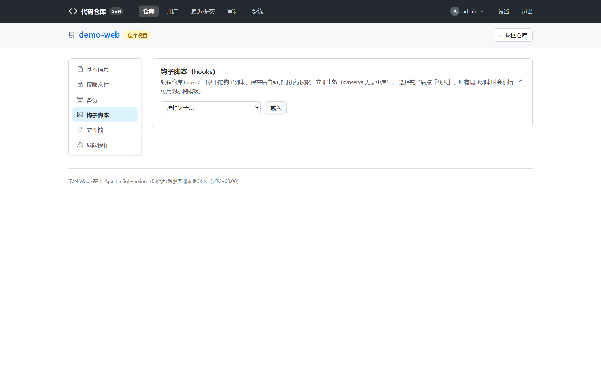
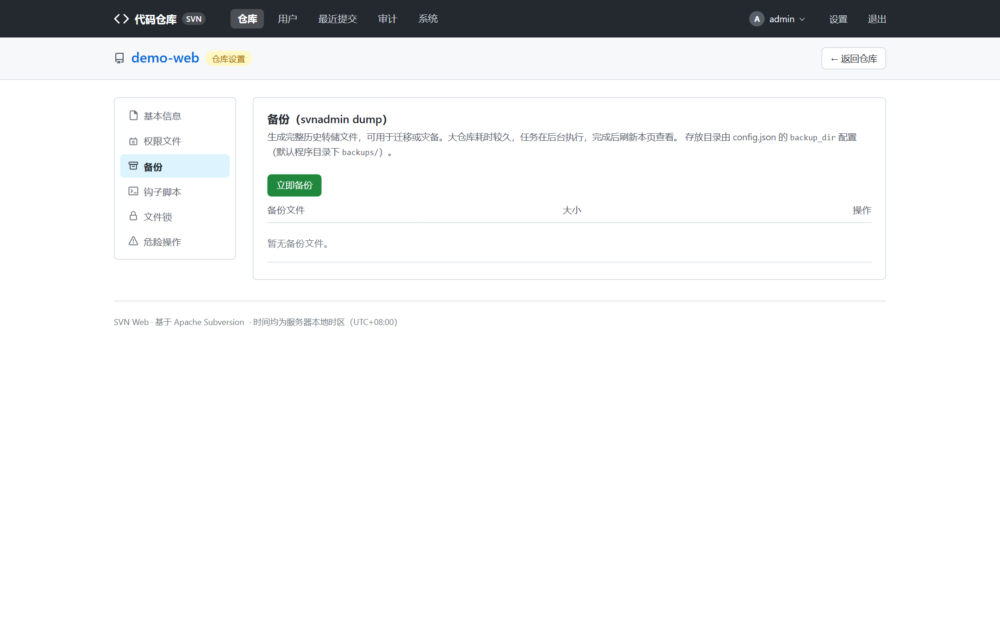

# 仓库管理

面向管理员（或被授予对应细粒度权限的角色）。入口：仓库页左侧「管理」边栏，
或首页顶部「新建仓库」。

> 每一项管理动作都会写入审计日志，见 [系统与运维 → 审计日志](system-ops.md)。

## 新建仓库

入口：首页「新建仓库」。

- 填仓库名与描述，提交后自动执行 `svnadmin create`，并**自动写入 svnserve 配置**，
  沿用既有账号权限体系——新建仓库即刻可被 `svn://` 检出。
- 创建成功页会展示检出地址与初始化导入命令（`svn import`），照抄即可。
- **仓库名有限制**：仓库直接作为顶层路径（`/<name>`），因此 `users`、`admin`、
  `recent`、`settings`、`audit`、`server` 等系统保留名不可用作仓库名，创建时自动校验拒绝。

## 归档与恢复

入口：仓库管理 → 危险操作；归档仓库统一在首页「已归档仓库」页管理：

- **归档**：仓库目录移入 `.archived/` 并去除读取权限（Linux 下 `chmod 000`），
  svnserve 与网页都无法再访问，等于「软删除」。
- **恢复**：移回原位、恢复权限，一切如初。
- **彻底删除**：从归档区物理删除，**不可恢复**，请先确认已有 `svnadmin dump` 备份。

## 重命名

入口：仓库管理 → 概览。重命名会同步清理相关缓存；检出地址随仓库名变化，
需通知团队成员。

## 账号与权限（本仓库）

入口：仓库管理 → 账号 / 组 / 权限。

- **账号一览**：本仓库 `conf/passwd` 中的 SVN 账号，可增改（明文存储是 svnserve 协议限制）。
- **用户组**：`conf/authz` 的 `[groups]` 节图形化编辑。
- **authz 编辑**：路径授权的图形化编辑 + 高级原文编辑双模式；原文编辑适合
  图形界面覆盖不了的复杂规则。

- 更省事的玩法：**不必逐仓库设账号**，去「用户管理」页用跨仓库的
  **权限矩阵**统一管理，见 [用户与角色](users-roles.md)。

## Hooks 在线编辑

入口：仓库管理 → 钩子。

- 可在线查看 / 编辑 `pre-commit`、`post-commit` 等 hook 脚本，保存即生效（无需重启）：

- 生成的是 **shell 脚本**（`SVNLOOK=/usr/bin/svnlook`），仅适用于 Linux svnserve；
  Windows svnserve 只认 `.bat` / `.exe`，需手工改写。

## 锁管理

入口：仓库管理 → 锁。列出 `svn lock` 加的全部锁定，支持**强制解除**（`svnadmin` 层面），
用于同事离职 / 客户端异常导致的死锁。

## 在线备份

入口：仓库管理 → 备份。

- 「立即备份」在后台线程执行 `svnadmin dump`，完成后列表出现备份文件，可直接下载：

- 备份文件默认存放在程序目录 `backups/`（可在 `config.json` 的 `backup_dir` 调整）。
- 备份文件可通过 `svnadmin load` 恢复到任意 Subversion 服务器，恢复命令页面有示例。
- 也可以随时从仓库管理页**打包下载整个仓库目录**（zip）。

## 分支与标签

入口：仓库页头（或版本列表旁）。

- 填来源路径与目标路径即可创建分支 / 标签，底层是 `svn copy --parents`。
- 目标已存在时会明确报错而不是静默复制成子节点。

## 相关文档

- 建完仓库想给同事开账号 → [用户与角色](users-roles.md)
- 备份文件管理、审计、系统状态 → [系统与运维](system-ops.md)
