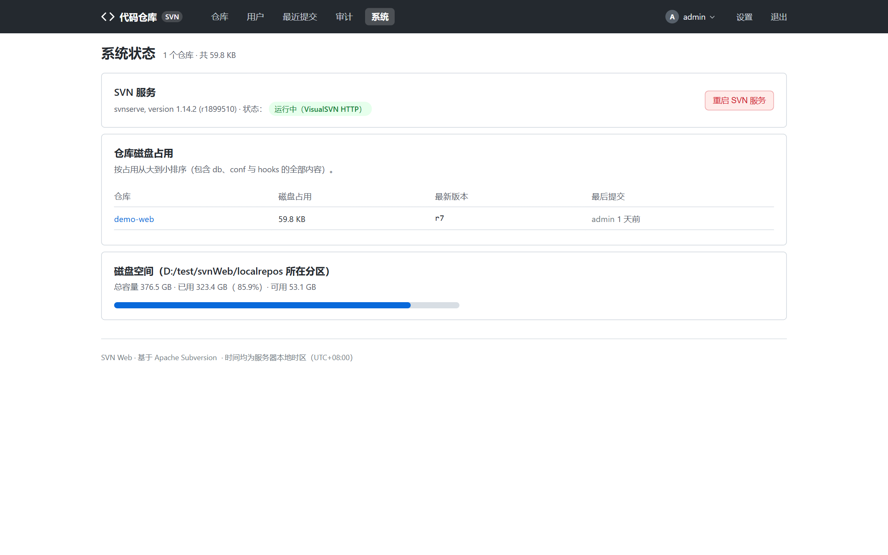
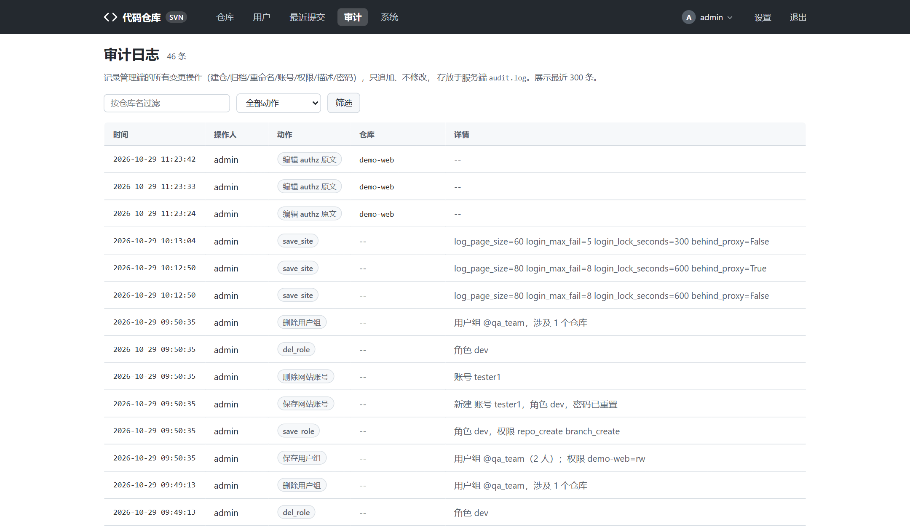

# 系统与运维

面向管理员的站点级运维功能：系统状态、审计日志、备份恢复与安全建议。

## 系统状态页

入口：顶部导航「系统」（`/server/`）。展示：



- **svnserve 服务状态**：进程是否在跑、3690 端口监听情况。
- **磁盘用量**：仓库根所在分区（仓库膨胀最容易把盘吃满，常看）。
- **仓库根目录**：当前 `repo_root` 及其下的仓库概况。
- **重启服务**：一键重启 svnweb 服务（需要运行账号有对应服务管理权限；
  Linux 下为 systemd 单元 `svnweb`）。

「站点设置」（`/settings/site`）可在线调整仓库根目录等配置。

## 审计日志

入口：顶部导航「审计」（`/audit/`）。



- 管理类操作**全埋点**：建仓、归档、删除、重命名、改账号、改权限、改 hook、
  备份、解锁、改密……全部记录。
- 每条记录含操作者、动作、对象仓库、时间与详情。
- 支持按**仓库**、按**动作类型**过滤；日志为 JSONL 文件（`audit.log`），
  有条数上限滚动清理。
- 查看 / 检索审计日志本身需要 `audit_view` 权限。

## 备份与恢复

### 备份手段

| 手段 | 操作位置 | 产物 |
| --- | --- | --- |
| 单仓库逻辑备份 | 仓库管理 → 备份 | `svnadmin dump` 文件，可在线下载 |
| 整仓目录打包 | 仓库管理 → 概览 | zip 压缩包 |
| 配置备份 | 手动复制 | `config.json`（含密码哈希，妥善保管） |

### 恢复

```bash
# dump 文件恢复到新仓库
svnadmin create /svn/<仓库>
svnadmin load /svn/<仓库> < 备份文件.dump
```

> **教训级提醒**：手动改 `config.json` 前务必备份原文件；备份文件只新建、
> 不要反复覆盖同一个文件——历史上发生过「自测脚本中途崩溃毁掉唯一配置文件」的事故。

## 安全建议

- **不要复用示例配置**：`secret_key` 必须随机，`config.json` 含密码哈希，
  已列入 `.gitignore`，勿提交公开仓库。
- **生产走 HTTPS**：nginx 443 反代 + `config.json` 设 `behind_proxy: true`，
  防火墙限制 37245 端口来源。
- **登录防爆破**：默认连续失败 5 次锁 300 秒，可按需调严。
- **SVN 侧 passwd 是明文**（svnserve 协议限制）：确保各仓库 `conf/` 目录
  仅运行用户可读（`chmod 600`）。
- **媒体预览白名单刻意排除 html / htm / js**：这是防 XSS 的设计，不要为了
  「预览方便」放宽。
- **viewer 角色对外**：只看不改的同事一律开 viewer 或自定义只读角色，别共用 admin。

## 日常巡检清单

1. 系统状态页：磁盘余量、svnserve 存活。
2. 审计日志：近几天有无异常管理操作。
3. 仓库管理 → 备份：关键仓库是否有近期 dump。
4. 「最近提交」页：全服提交动态是否正常。

## 相关文档

- nginx / systemd 部署细节 → 根目录 `README.md`「部署说明」
- 故障排查 → [常见问题](faq.md)
