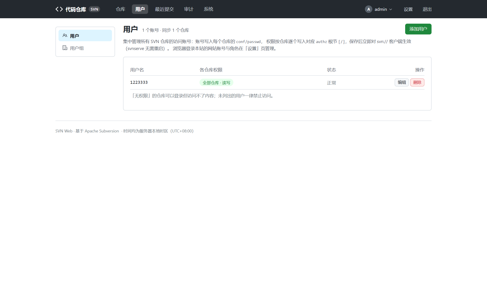
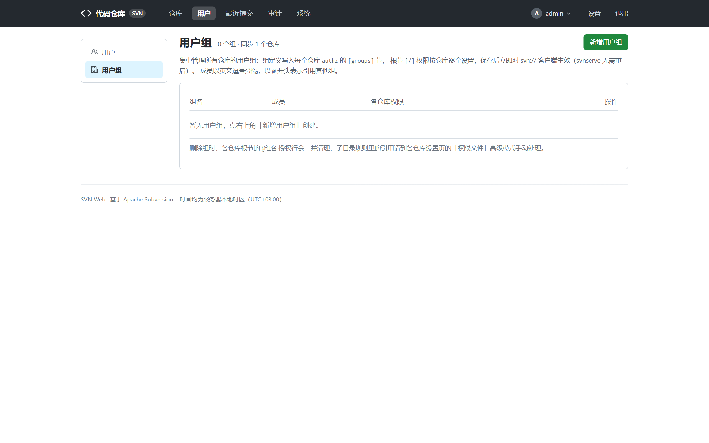
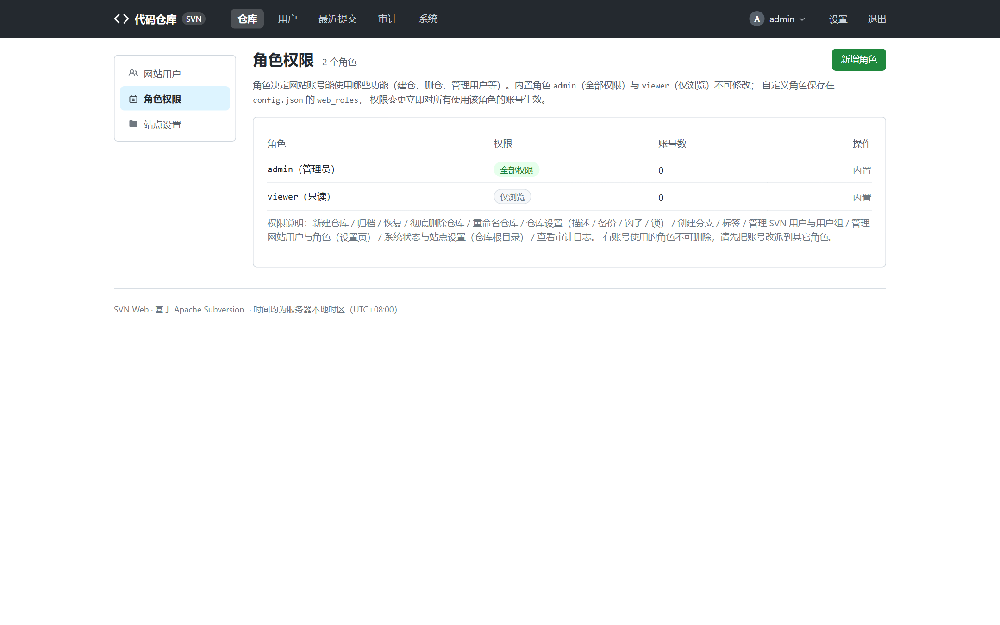
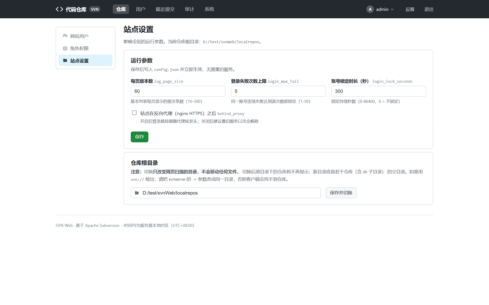

# 用户与角色

SVN Web 有两套互不相干的账号体系，先分清：

| | SVN 账号 | 网站账号（Web 用户） |
| --- | --- | --- |
| 用途 | `svn://` 检出 / 提交认证 | 登录本网站 |
| 存放 | 各仓库 `conf/passwd` + `conf/authz` | 站点 `config.json` |
| 管理入口 | 用户管理页（`/users/`） | 设置页（`/settings/`） |

两边密码互相独立：SVN 密码管命令行读写，网站密码管网页登录。

## SVN 权限矩阵（用户管理页）

入口：顶部导航「用户管理」（`/users/`）。

这是最常用的账号管理方式——**集中建一份账号，一次勾选同步到所有仓库**：

1. **账号列表**：新增 / 修改 / 删除 SVN 账号，保存时写入每个仓库的 `conf/passwd`。
2. **权限矩阵**：每行一个用户、每列一个仓库，单元格三态：
   - **读写**（`rw`）
   - **只读**（`r`）
   - **无**（不出现在 authz，不可访问）
3. 支持按行 / 列批量操作（如「对所有仓库应用同一权限」），保存即同步到
   所有仓库的 `passwd` / `authz` 文件——网页上所见即所得。
4. **用户组**页签管理 `conf/authz` 的 `[groups]` 节：

> 单仓库的个性化规则（个别路径授权等）仍可去该仓库的「管理 → 权限」用
> authz 原文编辑处理，两处写的是同一批文件。

## 网站账号与角色（设置页）

入口：顶部导航「设置」（`/settings/`），共三个页签：

### 网站用户

增删改网站登录账号（存 `config.json` 的 `web_users`），每个账号必须挂一个角色。
在这里也可以修改自己的密码（改密后会话不掉线）。

### 角色权限

角色决定这个网站账号**能做什么**。内置两个角色：

- **admin**：全部权限（`*`）。
- **viewer**：纯只读，仅浏览查看。

可以**新建自定义角色**，按 9 项细粒度权限勾选：

| 权限项 | 说明 |
| --- | --- |
| `repo_create` | 新建仓库 |
| `repo_archive` | 归档 / 恢复 / 彻底删除仓库 |
| `repo_rename` | 重命名仓库 |
| `repo_admin` | 仓库设置（描述 / 备份 / 钩子 / 锁） |
| `branch_create` | 创建分支 / 标签 |
| `user_manage` | 管理 SVN 用户与用户组 |
| `web_manage` | 管理网站用户与角色（设置页） |
| `server_manage` | 系统状态与站点设置（仓库根目录） |
| `audit_view` | 查看审计日志 |

典型用法：给运维同事开一个只勾 `repo_admin` + `user_manage` 的角色，
给 QA 开 `audit_view`，不必人人都给全权 admin。

### 站点设置

仓库根目录、每页条数、登录防爆破阈值等站点级配置的在线调整（等价于手改
`config.json` 的对应键，保存即生效）：

## 权限怎么叠加

- 登录账号 → 所属角色 → 角色的权限集合，`has_perm()` 逐项判定。
- 没有对应权限的导航入口不会出现；直接访问 URL 会被拒绝（403）。
- SVN 侧（检出 / 提交）的权限与网站角色**无关**，只由权限矩阵写进
  `passwd` / `authz` 的内容决定。

## 相关文档

- 权限矩阵落盘的文件格式 → [仓库管理 → 账号与权限](repo-admin.md#账号与权限本仓库)
- 误操作了？看审计日志 → [系统与运维](system-ops.md)
